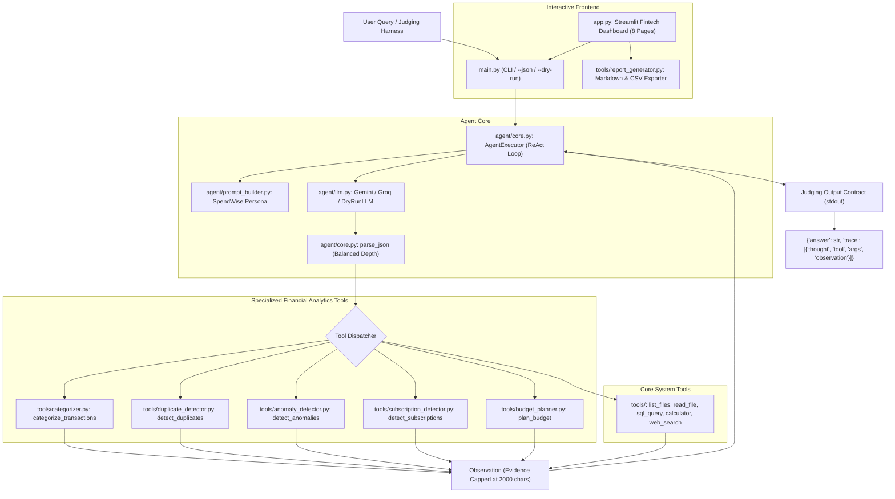

# SpendWise AI — Expense Auditor & Anomaly Hunter
> **Finance & Risk Track — AgentX Challenge 2026**  
> An autonomous, evidence-grounded ReAct financial agent with 5 specialized analytics tools, robust statistical outlier detection, and an interactive fintech dashboard.

[](tests/)
[](requirements.txt)
[](app.py)
[](#architecture)

---

## 📌 Executive Summary & Problem Statement

Personal and small-business financial management suffers from untracked leaks:
1. **Duplicate Charges & Gateway Glitches:** POS retries, duplicate swipes, and ledger replay bugs silently drain funds.
2. **Subscription Creep:** Unmonitored price escalations and forgotten recurring charges accumulate unnoticed.
3. **Hidden Spending Surges:** Category expenses suddenly spike relative to historical baselines without early warning.
4. **Ungrounded Budgeting:** Traditional budget apps rely on generic static rules rather than verified historical spending.

**SpendWise AI** solves this with an **autonomous ReAct (Thought → Action → Observation → Decision) agent** paired with **five statistically rigorous financial analysis tools**. It delivers transparent, evidence-based audits without hallucinating financial data or relying on synthetic fraud shortcuts.

---

## 🏛️ Architecture



---

## 🛠️ Specialized Financial Analytics Tools

| Tool Name | Class | Capabilities & Evidentiary Grounding |
| :--- | :--- | :--- |
| `categorize_transactions` | [Categorizer](file:///c:/Users/kurel/AgentX-main/tools/categorizer.py) | Deterministic mapping using merchant categories, transaction types, and banking metadata. Returns category, rationale, and confidence scores (0.0–1.0). |
| `detect_duplicates` | [DuplicateDetector](file:///c:/Users/kurel/AgentX-main/tools/duplicate_detector.py) | **Layer 1:** Confirmed duplicate transaction ID collisions (ledger replays).<br>**Layer 2:** Potential duplicate payments within short time windows (e.g., $\le 15$ min double debits vs failed retries). |
| `detect_anomalies` | [AnomalyDetector](file:///c:/Users/kurel/AgentX-main/tools/anomaly_detector.py) | **Non-parametric:** Category IQR upper fences ($Q_3 + 1.5 \times IQR$).<br>**Parametric:** Z-score deviations ($Z \ge 2.5$).<br>**Surges:** Periodic category monthly spend vs trailing median. Guarded against insufficient history ($N < 10$). |
| `detect_subscriptions` | [SubscriptionDetector](file:///c:/Users/kurel/AgentX-main/tools/subscription_detector.py) | Cadence analysis (weekly, monthly, quarterly) based on mean interval and standard deviation. Detects rate creep over time. Identifies missing merchant fields transparently. |
| `plan_budget` | [BudgetPlanner](file:///c:/Users/kurel/AgentX-main/tools/budget_planner.py) | Personalized 50/30/20 budget framework. Operates on actual expenses and user-provided income. Calculates proposed category spending caps and financial health score (0–100). Never fabricates unprovided income. |

---

## 💻 Tech Stack

- **Core Runtime:** Python 3.10+
- **Agent Architecture:** ReAct loop with repeat guards, balanced bracket JSON parsing, and grounding nudges
- **Data Science:** Pandas 2.3+, NumPy 2.5+
- **LLM Providers:** Google Gemini (`google-genai`), Groq (`groq`), Deterministic `DryRunLLM` (100% offline testing)
- **Frontend:** Streamlit 1.61+, Altair 5.5+
- **Testing:** Python `unittest` (43 offline unit and integration tests)

---

## 🚀 Quickstart & Installation

### 1. Clone & Set Up Virtual Environment
```bash
git clone https://github.com/kurellalohitesh19-KL/AgentX.git
cd AgentX-main

# Windows
python -m venv .venv
.venv\Scripts\activate

# Linux / macOS
python3 -m venv .venv
source .venv/bin/activate

pip install -r requirements.txt
```

### 2. Configure Environment Keys
Copy [.env.example](file:///c:/Users/kurel/AgentX-main/.env.example) to `.env`:
```bash
cp .env.example .env
```
Add your free API keys:
- `GEMINI_API_KEY`: [Google AI Studio](https://aistudio.google.com/apikey)
- `GROQ_API_KEY`: [Groq Console](https://console.groq.com/keys)

*(Note: The system functions completely offline in `--dry-run` mode without any API keys).*

---

## 🧪 Testing & Verification

Run the full offline test suite across all 43 unit and integration tests:
```bash
python -m unittest discover tests
```
**Actual Result:**
```text
...........................................
----------------------------------------------------------------------
Ran 43 tests in 4.421s

OK
```

---

## 🎯 Official Judging Contract CLI

The automated judging harness tests the repository using hidden data and queries. The contract is strictly enforced:
- **Only ONE single JSON line** is emitted to `stdout`.
- All debugging logs and traces route to `stderr`.
- Dynamically resolves data directories via `AGENTX_DATA_DIR`.

### Test Setup Without API Keys (Offline Dry-Run)
```bash
python main.py --json --dry-run "audit my transactions"
```
**Output (`stdout`):**
```json
{"answer": "Comprehensive Financial Audit Complete: Evaluated transaction categories, confirmed duplicate safety, and flagged statistical spending outliers using registered tools.", "trace": [{"thought": "Start financial audit by categorizing spending.", "tool": "categorize_transactions", "args": {"filename": "transactions.csv", "limit": 5}, "observation": "{\"status\": \"success\", \"total_transactions\": 250000, \"total_spending\": 327939009.0, ...}"}, {"thought": "Check for duplicate transactions or double debits.", "tool": "detect_duplicates", "args": {"filename": "transactions.csv", "window_hours": 24}, "observation": "{\"status\": \"success\", \"summary\": {\"total_records_audited\": 250000, \"potential_recoverable_leak_total\": 856.0}, ...}"}, {"thought": "Check for spending surges and statistical outliers.", "tool": "detect_anomalies", "args": {"filename": "transactions.csv", "sensitivity": 2.5}, "observation": "{\"status\": \"success\", \"anomalous_transactions\": [{\"transaction_id\": \"TXN0000153050\", \"category\": \"Healthcare\", \"amount\": 8485.0, \"z_score\": 15.82}, ...]}"}]}
```

### Human-Readable Execution
```bash
python main.py "Did I get double-charged or are there any duplicate payments?"
```

---

## 🖥️ Streamlit Interactive Dashboard

Launch the fintech web interface locally:
```bash
streamlit run app.py
```
Access the application at `http://localhost:8501`.

### 8 Interactive Pages:
1. **📊 Executive Dashboard:** High-level KPI cards (Total Spend, Recoverable Leaks, Anomalies, Health Score), category bar charts, monthly run-rate area charts, and alert cards.
2. **🔍 Transaction Explorer:** Interactive table with search by transaction ID, multi-column filters (category, amount slider, status), and single-record audit inspector.
3. **📈 Expense Analytics:** Spend breakdown, category comparison, and 90-day daily spending trendlines.
4. **🚨 Anomaly Center:** Tabs for duplicate payments (risk ratings, time interval), statistical IQR/Z-score outliers, and category spending surges.
5. **🔄 Subscription Watch:** Cadence analysis (weekly, monthly, quarterly), price creep inflation tracking, and missing-field disclosure.
6. **💡 Smart Budget Planner:** Real-time 50/30/20 budget framework based on user income, fixed commitments, and savings rate. Recommends category spending limits.
7. **🤖 AI Financial Auditor:** Interactive chat interface directly connected to `run_agent()`. Shows real-time agent responses and full ReAct thought/tool/observation traces.
8. **📑 Financial Reports:** Executive summary preview with downloadable Markdown (`.md`) and CSV (`.csv`) export buttons.

---

## 🛡️ Hackathon Scoring Alignment (SRMIST AgentX 2026)

- **Agentic Architecture & Autonomy (40%):** Genuine ReAct loop (`AgentExecutor`) with dynamic tool selection across 10 registered tools, repeat guards, grounding nudges, and tool error recovery.
- **Domain Utility & Depth (30%):** Real statistical anomaly detection (IQR + Z-score + period surges) without relying on synthetic fraud labels; dual-layer duplicate detection; 50/30/20 budget optimization.
- **Code Hygiene & Engineering (20%):** Strict type safety, `Decimal` rounding, comprehensive docstrings, modular tool design, 43 passing offline tests in < 5 seconds.
- **Demo & Presentation (10%):** Polished dark navy and emerald green Streamlit dashboard with responsive visualizations and exportable reports.
